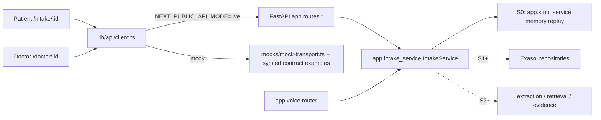

# Design — Dermatology Case Navigator

Canonical sources: `docs/02-product-and-architecture.md` (architecture, tables),
`docs/03-api-contract.md` (routes, sequences), `contracts/domain.schema.json` (domain shapes),
`contracts/DECISIONS.md` (S0 reconciliation).

## Components

## Key decisions

- **One seam.** `IntakeService` (Protocol) in `app/intake_service.py`, injected with `Depends(get_intake_service)`. Zoro swaps the implementation behind `get_intake_service`; route and voice modules never change for it.
- **One contract.** Pydantic DTOs in `app/models.py` mirror the domain schema; `tests/test_contract_alignment.py` fails on drift. FastAPI exports `contracts/openapi.json`; `openapi-typescript` generates `apps/web/lib/api/generated.ts`. Both are checked for drift in CI.
- **Shared examples.** `contracts/examples/**` are parsed by backend tests and copied into `apps/web/mocks/fixtures` for the browser mock. No independently designed mock shapes.
- **Explicit modes.** Web: `NEXT_PUBLIC_API_MODE=mock|live`, always shown. API: snapshot `modes` reports what the implementation does (S0 stub always `memory`/`fixture`).
- **Next.js 16 specifics.** Cache Components is on: dynamic pages render client views inside `<Suspense>`; previously visited routes stay mounted but hidden (`<Activity>`), so tests select by role. Tokens are read with `useSyncExternalStore` from `sessionStorage`.
- **Security defaults.** HMAC-derived session tokens stored as SHA-256 hashes, constant-time checks, same 404 for unknown session and wrong token, CORS allowlist, validation errors never echo input, no secrets in `NEXT_PUBLIC_*`.

## Doctor grid (desktop, 12 columns)

Brief 7 | Cards or no-match 5 · Changes 7 | Clarify 5 · Clinician note 12. Stacks in reading order below `lg`.
