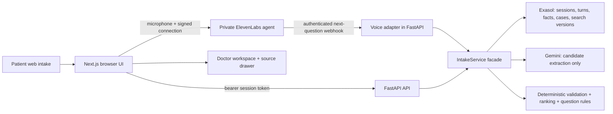

# Product and architecture

## Scope that fits sixteen working hours

Required: fictional patient intake by voice and text; editable/source-linked patient turns; supported structured facts; up to two follow-up questions; deterministic case filtering and ranking; before/after explanation; patient confirmation; doctor brief; case cards with source drawer; no-match path; separate clinician note; visible live/mock/source mode; persistence in Exasol.

Stretch in order: doctor correction UI using the existing correction endpoint; local-only photo preview; broader reviewed collection. If the photo is previewed only on the patient device, clearly say it is not shared with the doctor. Do not claim photo handoff without implementing actual storage and access. MVP can omit photos entirely.

Out of scope: diagnosis, treatment selection, triage engine, medical image analysis, EHR integration, vector infrastructure, native mobile, multilingual intake, real patient enrollment, production compliance certification, full clinician account/role system. A shared-code fictional demo is not a real authorization system for patient care.

## Architecture



The signed-URL route runs in Next.js server code, validates the session through the backend, obtains a short-lived voice binding and asks ElevenLabs for a signed connection URL. Browser transcript events are persisted through FastAPI. The voice webhook receives only a scoped binding token, never trusts an LLM-supplied patient ID, and calls the same intake service as text intake.

## Deliberately simple retrieval

Exasol stores reviewed case features and supporting passages. Queries fetch eligible cases and their feature evidence from Exasol. Python applies a small versioned scoring/gating function, then Exasol persists the exact inputs, candidate scores, excluded reasons, ranking and case versions. This is genuine Exasol-backed retrieval and traceability; do not claim native vector search, clinical validation, or submillisecond scale benefits from a tiny collection.

Use a synchronous request-response pipeline; no queue, agent framework, Redis or background worker. Backend runs one process/worker initially. Use a serialized per-session operation and revision checks; do not share a single non-thread-safe database connection across concurrent requests. A simple per-operation connection or safe connection wrapper is enough. Keep provider calls outside database transactions and commit coherent snapshots only after validation. Persist idempotency results so retries do not duplicate turns or questions.

## Repository structure

```text
AGENTS.md
.kiro/steering/
.github/workflows/web.yml
.github/workflows/api.yml
apps/web/                     # Luffy: own package.json and package-lock.json
  app/                        # patient route, doctor route, signed-url server route
  components/                 # modular panels and source drawer
  lib/api/                    # generated types and typed client
  lib/voice/                  # SDK adapter + transcript synchronization
  mocks/                      # fixture HTTP responses, same contract
  tests/
services/api/                 # Zoro except app/voice and test_voice*
  app/main.py                 # bootstrap registers both routers once
  app/models.py
  app/intake_service.py       # stable facade used by both routers
  app/routes/
  app/voice/                  # Luffy; webhook and scoped binding adapter
  app/repositories/
  app/extraction/
  app/retrieval/
  app/evidence/
  scripts/                    # init_db, seed, smoke, export_openapi
  tests/
  requirements.txt
contracts/                    # Zoro after S0; shared public schema
data/synthetic/               # fixtures shipped in this pack
data/reviewed/                # real cases only after review
docs/status/luffy.md
docs/status/zoro.md
```

## Ownership and workload

Luffy handles application skeleton, all UI, voice SDK/agent configuration, backend voice adapter, frontend CI, Vercel and demo presentation. Zoro handles contract implementation, encounter pipeline, extraction, Exasol tables/queries, ranking, data tooling, backend CI and Render. Both review sources: Zoro prepares/imports, Luffy independently checks the on-screen passages. This balances the work; Zoro is not also expected to deliver embeddings, complex crawling, photo storage or advanced model reasoning.

The `IntakeService` interface is frozen at S0. Both HTTP routers call it; Luffy's voice module never executes SQL or implements medical extraction. Zoro never configures ElevenLabs or edits React state management. Register a stub voice router in the bootstrap so neither developer needs to keep editing `app/main.py`.

## Exasol tables

Use stable UUIDs created in the application. Exasol uniqueness/constraint behavior must not be assumed to provide encounter concurrency control; enforce revisions and idempotency in the service. Use bounded strings or supported large-text types after verifying limits; do not assume a PostgreSQL JSONB type.

| Logical table | Required information |
|---|---|
| COLLECTIONS | ID, mode, version/hash, review counts |
| CASES | ID, collection, kind, article IDs/URL when real, source/license/review status, case version |
| PASSAGES | ID, case, immutable exact text, section, source locator, text hash |
| CASE_FACTS | ID, case, key, value, polarity, passage references, review status |
| CASE_STATEMENTS | action/outcome statement, passage references, review status |
| SESSIONS | ID, token hash, current revision, state, confirmed revision, selected collection, expiry |
| TURNS | ID, session, role, origin, exact text, order, timestamp, supersedes ID, revision |
| FACTS | ID, session/revision, key/value, status, supporting quote/turn IDs |
| QUESTIONS | question ID, session, kind, template, evidence refs, supporting difference, asked/answered/skipped |
| SEARCH_VERSIONS | immutable input facts, algorithm version, collection hash, candidate case versions, rankings, gate reasons, diffs |
| CLINICIAN_NOTES | ID, session, patient revision, note text, author label, timestamp; never merged into patient facts |
| OPERATIONS | session, request ID, input hash, result, revision for idempotent retries |

For hackathon speed, normalized tables for cases/passages/features plus serialized validated JSON payloads for encounter snapshots are acceptable. Keep explicit session/revision/operation IDs queryable. Document the simplification; do not add a generic event-sourcing framework.

## Clinical and trust boundaries

Sources are examples, not proof of efficacy. A disclaimer does not validate a clinical workflow or establish regulatory exemption. All demo patients are fictional. A developer source-review flag means the text was checked, not that medical relevance was clinically validated.

If no clinician is available, label the intake questions as a prototype checklist awaiting clinical review. Never claim “clinician-reviewed” based only on this pack. For a real deployment, the workflow would need clinical evaluation, privacy/security design and appropriate assessment; those are outside this prototype's claims.

The voice agent does not troubleshoot potentially urgent symptoms using improvised advice. For the hackathon, show a fixed “This demo cannot assess urgent concerns; contact appropriate medical services for urgent help” notice and let the user stop. Do not promise the prototype detects emergencies.
